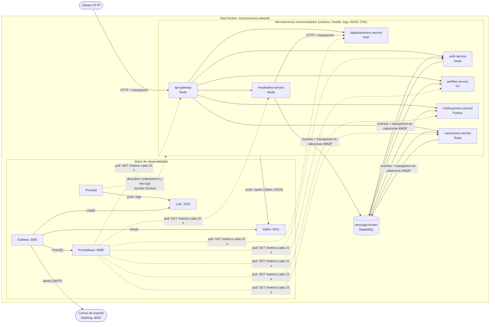
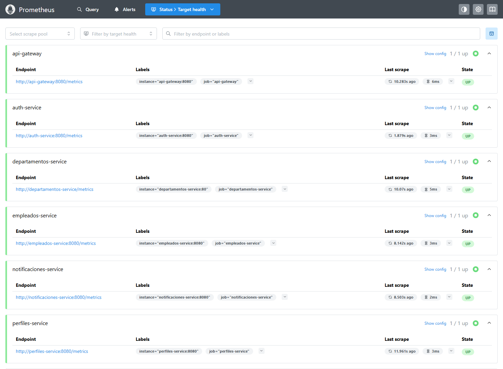
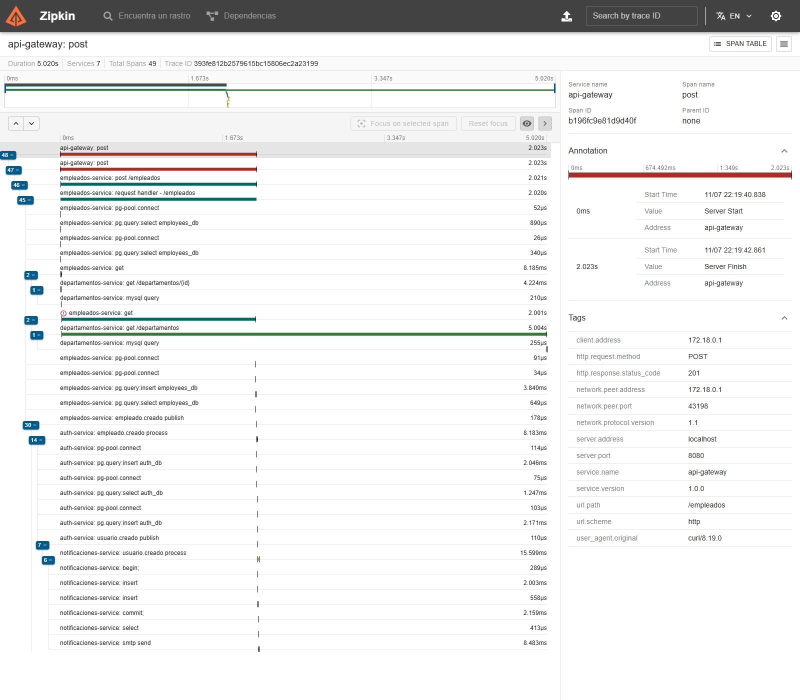
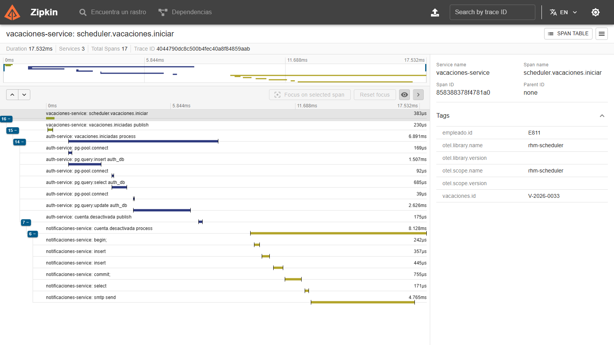
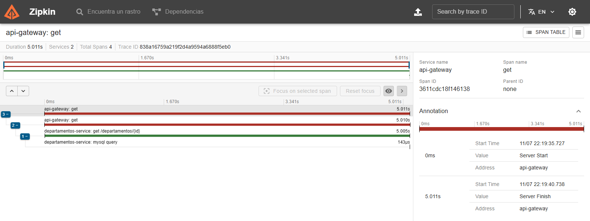
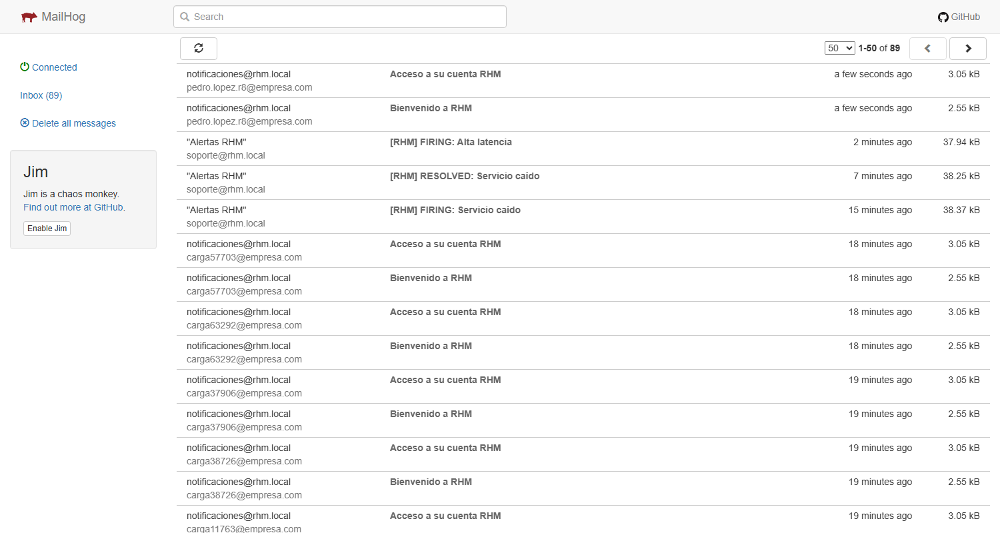
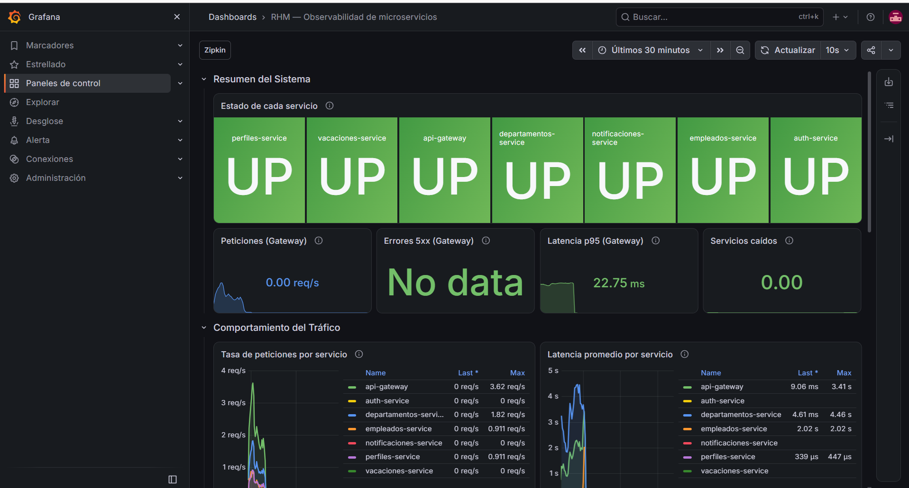

# Plataforma RHM — infraestructura

Este repositorio contiene el único `docker-compose.yml` del sistema. Levanta el API Gateway, los
microservicios y sus bases de datos aisladas con un solo comando.

| Componente | Tecnología | Puerto host | Volumen / dependencia |
|---|---|---:|---|
| `api-gateway` | Node.js + TypeScript | 8080 | empleados, departamentos, notificaciones, perfiles, vacaciones |
| `empleados-service` | Node.js + TypeScript | interno 8080 (sin publicar) | `database-empleados` |
| `database-empleados` | PostgreSQL 17 | interno 5432 (sin publicar) | `employees-db-data` |
| `departamentos-service` | PHP 8.3 + Apache | interno 80 (sin publicar) | `database-departamentos` |
| `database-departamentos` | MySQL 8.4 | interno 3306 (sin publicar) | `departments-db-data` |
| `message-broker` | RabbitMQ 4 (management) | 5672 (AMQP) y 15672 (UI), solo localhost | `broker-data` |
| `notificaciones-service` | Python + FastAPI | interno 8080 (sin publicar) | `database-notificaciones` |
| `database-notificaciones` | PostgreSQL 17 | interno 5432 (sin publicar) | `notifications-db-data` |
| `perfiles-service` | Go | interno 8080 (sin publicar) | `database-perfiles` |
| `database-perfiles` | PostgreSQL 17 | interno 5432 (sin publicar) | `profiles-db-data` |
| `vacaciones-service` | Ruby + Sinatra | interno 8080 (sin publicar) | `database-vacaciones` |
| `database-vacaciones` | PostgreSQL 17 | interno 5432 (sin publicar) | `vacations-db-data` |
| `auth-service` | Node.js + TypeScript | interno 8080 (sin publicar) | `database-auth` |
| `database-auth` | PostgreSQL 17 | interno 5432 (sin publicar) | `auth-db-data` |
| `mailhog` | MailHog | 8025 (UI), solo localhost | — |
| `jenkins` | Jenkins LTS (JDK 21) — CI, Reto 7 | 9090 | `jenkins-data`, socket Docker del host |
| `sonarqube` | SonarQube 9.9 LTS Community — Reto 7 | 9000 | `sonar-db`, `sonarqube-*` |
| `sonar-db` | PostgreSQL 17 | interno 5432 (sin publicar) | `sonar-db-data` |
| `sonar-init` | one-shot (curl) que aprovisiona SonarQube | — | `sonar-token` |
| `registry` (`docker-registry`) | Docker Registry 2 — Reto 7 | 5000 | `registry-data` |
| `prometheus` | Prometheus — métricas, Reto 8 | 9091 (interno 9090) | `prometheus-data` |
| `grafana` | Grafana — dashboards y alertas, Reto 8 | 3000 | `grafana-data`, `observability/grafana` |
| `loki` | Loki — logs, Reto 8 | 3100 | `loki-data` |
| `promtail` | Promtail — recolector de logs, Reto 8 | — | socket Docker del host (solo lectura) |
| `zipkin` | Zipkin — trazas distribuidas, Reto 8 | 9411 | en memoria |

La única entrada HTTP publicada para los microservicios es `http://localhost:8080`, servida por el
Gateway. Dentro de Docker, el Gateway enruta `/empleados/*` a `empleados-service:8080`,
`/departamentos/*` a `departamentos-service:80`, `/notificaciones/*` a
`notificaciones-service:8080`, `/perfiles/*` a `perfiles-service:8080`, `/vacaciones/*` a
`vacaciones-service:8080` y `/auth/*` a `auth-service:8080`. Cada servicio usa su propia base de datos
(`database-empleados:5432`, `database-departamentos:3306`, `database-notificaciones:5432`,
`database-perfiles:5432`, `database-vacaciones:5432`); ningún servicio consulta la base de datos de
otro.

Ninguna base de datos publica su puerto al host: ya no es posible conectarse con `psql`/`mysql`
desde la máquina local a `localhost:5433` o `localhost:3307` como en el Reto 2. Solo `api-gateway`
(puerto `8080`) y `message-broker` (puertos `5672`/`15672`, para su management UI) quedan accesibles
fuera de la red Docker.

## Lenguajes del ecosistema (Reto 4)

El enunciado exige al menos 4 lenguajes distintos en el proyecto final. Este reto los completa:

| Servicio | Lenguaje / framework | Repositorio |
|---|---|---|
| `empleados-service` | Node.js + TypeScript (Express) | [ms-employees](https://github.com/Microservicios-RHM/ms-employees) |
| `departamentos-service` | PHP 8.3 (Apache) | [ms-departments](https://github.com/Microservicios-RHM/ms-departments) |
| `api-gateway` | Node.js + TypeScript (Express) | [api-gateway](https://github.com/Microservicios-RHM/api-gateway) |
| `notificaciones-service` | Python + FastAPI | [ms-notifications](https://github.com/Microservicios-RHM/ms-notifications) |
| `perfiles-service` | Go (biblioteca estándar `net/http`) | [ms-profiles](https://github.com/Microservicios-RHM/ms-profiles) |
| `vacaciones-service` | Ruby + Sinatra | [ms-vacation](https://github.com/Microservicios-RHM/ms-vacation) |
| `auth-service` | Node.js + TypeScript (Express) | [auth-service](https://github.com/Microservicios-RHM/auth-service) |

Cinco lenguajes distintos (Node/TypeScript, PHP, Python, Go, Ruby) — uno más que el mínimo exigido.
Los tres servicios nuevos del Reto 4 (`notificaciones`, `perfiles`, `vacaciones`) están en tres
lenguajes distintos entre sí y distintos de los ya usados en `empleados`/`departamentos`, tal como
pide el enunciado.

## Message broker (Reto 4)

Se evaluaron tres opciones:

- **RabbitMQ** — protocolo AMQP maduro, exchanges/colas con bindings explícitos, UI de
  administración web incluida en la imagen oficial (`rabbitmq:4-management-alpine`), y es la que da
  el propio enunciado como referencia.
- **Kafka** — mayor throughput y retención tipo log, pero requiere operar Zookeeper/KRaft y está
  sobredimensionado para el volumen de este ecosistema (4 tipos de evento, 3 consumidores).
- **NATS** — muy ligero y de baja latencia, pero su consola de administración es más limitada que la
  de RabbitMQ para inspeccionar colas y republicar mensajes manualmente (requisito de la prueba de
  deduplicación).

Se eligió **RabbitMQ** por su UI de administración (necesaria para republicar manualmente un mensaje
y demostrar la deduplicación), su modelo de exchange `topic` que expresa naturalmente el fan-out
(un evento, múltiples colas enlazadas), y por tener clientes maduros en los 5 lenguajes usados en el
ecosistema (Node, PHP, Python, Go, Ruby).

Diseño de exchange/colas y contrato de cada evento: [`docs/event-catalog.md`](docs/event-catalog.md).

**Reto 4 completo.** Los 4 eventos del catálogo tienen productor y consumidores:

- `empleados-service` publica `empleado.creado`, `empleado.actualizado` y `empleado.retirado`.
- `vacaciones-service` (Ruby/Sinatra) publica `vacaciones.programadas` al programar un período
  exitosamente, y consume `empleado.creado`/`empleado.retirado` para su réplica local de empleados
  válidos (justificación de esa decisión en su propio README).
- `notificaciones-service` (Python/FastAPI) consume los 3 eventos que le corresponden
  (`BIENVENIDA`, `DESVINCULACION`, `VACACIONES`).
- `perfiles-service` (Go) consume los 3 eventos de empleado (crea/sincroniza/archiva el perfil).

Deduplicación verificada de punta a punta republicando manualmente mensajes desde la API de
RabbitMQ, en los tres consumidores. Los 5 servicios (`empleados`, `departamentos`,
`notificaciones`, `perfiles`, `vacaciones`) están registrados en el API Gateway.

Acceso a la UI de administración una vez levantado el stack:

```text
http://localhost:15672
Usuario: admin (o el valor de BROKER_USER)
Password: admin (o el valor de BROKER_PASSWORD)
```

### Validación de existencia del empleado en `vacaciones-service`

El enunciado exige justificar esta decisión explícitamente. `vacaciones-service` consume
`empleado.creado`/`empleado.retirado` y mantiene su propia réplica local mínima de empleados
válidos, en vez de consultar `empleados-service` por REST en cada `POST /vacaciones`. Se prioriza
**disponibilidad sobre consistencia inmediata**: programar vacaciones no debe depender de que otro
servicio esté arriba en ese instante. Justificación completa, con la contrapartida (inconsistencia
eventual) documentada sin ocultarla, en el
[README de `ms-vacation`](https://github.com/Microservicios-RHM/ms-vacation#decisión-técnica-validación-de-existencia-del-empleado).

## Inicio

Desde esta carpeta:

```bash
cp .env.example .env
docker compose up --build
```

Verifica el arranque ordenado (los 12 contenedores deben quedar `healthy`; toma un par de minutos
por las migraciones y las dependencias en cadena):

```bash
docker compose ps
```

```text
Gateway:         http://localhost:8080
Empleados:       http://localhost:8080/empleados
Departamentos:   http://localhost:8080/departamentos
Notificaciones:  http://localhost:8080/notificaciones
Perfiles:        http://localhost:8080/perfiles
Vacaciones:      http://localhost:8080/vacaciones
Health Gateway:  http://localhost:8080/health
RabbitMQ (UI):   http://localhost:15672
Jenkins (CI):    http://localhost:9090   (ver "Integración continua", Reto 7)
SonarQube:       http://localhost:9000
Registry:        http://localhost:5000/v2/_catalog
Grafana:         http://localhost:3000   (ver "Observabilidad y monitoreo", Reto 8)
Prometheus:      http://localhost:9091
Zipkin:          http://localhost:9411

Ningún microservicio ni base de datos publica su puerto HTTP directamente al host — todos son
alcanzables solo dentro de `microservices-network` (`empleados-service:8080`,
`departamentos-service:80`, `notificaciones-service:8080`, `perfiles-service:8080`,
`vacaciones-service:8080`). El único punto de entrada es el Gateway en `:8080`, más
`message-broker` en `:5672`/`:15672` para inspección manual (management UI, prueba de
deduplicación).

## API Gateway y Circuit Breaker

El cliente externo utiliza únicamente `http://localhost:8080`, publicado por `api-gateway`:

| Ruta pública | Destino interno |
|---|---|
| `/health` | API Gateway |
| `/empleados/*` | `empleados-service:8080` |
| `/departamentos/*` | `departamentos-service:80` |
| `/notificaciones/*` | `notificaciones-service:8080` |
| `/perfiles/*` | `perfiles-service:8080` |
| `/vacaciones/*` | `vacaciones-service:8080` |

Cada servicio monta su Swagger UI y su `openapi.json` bajo su propio prefijo de negocio (el mismo
que ya proxea la tabla de arriba, sin reescritura de ruta), así que quedan alcanzables detrás del
Gateway sin ninguna regla adicional:

```text
http://localhost:8080/empleados/docs
http://localhost:8080/departamentos/docs
http://localhost:8080/notificaciones/docs
http://localhost:8080/perfiles/docs
http://localhost:8080/vacaciones/docs
```

`empleados-service` valida departamentos mediante HTTP y no accede directamente a MySQL. La
operación está protegida por un Circuit Breaker con `opossum`, configurado en el servicio
consumidor:

```dotenv
DEPARTMENTS_CIRCUIT_BREAKER_THRESHOLD=3
DEPARTMENTS_CIRCUIT_BREAKER_RESET_TIMEOUT_MS=30000
DEPARTMENTS_CACHE_TTL_SECONDS=300
```

La caché `node-cache` se mantiene dentro de `empleados-service`: almacena únicamente validaciones
positivas de Departamentos. Ante timeout, error o Circuit Breaker `OPEN`, permite registrar solo si
existe una entrada vigente; sin ella responde `503`. Al ser local por instancia, Redis sería la
evolución necesaria para varias réplicas.

Después de un mínimo de tres operaciones, una tasa de fallo de al menos 50 % en una ventana de
60 segundos abre el circuito. Los retries internos conservan tres intentos, timeout por intento de
2 segundos, backoff y timeout total de 9 segundos; la operación completa cuenta como un único
fallo del Circuit Breaker. Un `404` de departamentos conserva el flujo `DEPARTMENT_NOT_FOUND` con
HTTP 400 y no abre el circuito.

En `OPEN`, no se ejecutan nuevas llamadas a departamentos y el registro responde HTTP 503 con
`DEPARTMENT_SERVICE_UNAVAILABLE`. No se agregó `PENDIENTE_VALIDACION` al modelo ni al esquema de
PostgreSQL porque ese estado no pertenece al dominio actual. Después de 30 segundos, `HALF_OPEN`
permite una llamada de prueba: un éxito devuelve el circuito a `CLOSED` y un fallo lo mantiene en
`OPEN`. Las transiciones y los fallos se registran con Pino en `empleados-service`.

Para reproducir la prueba controlada sin eliminar volúmenes:

```bash
docker compose stop departamentos-service
# realizar tres POST /empleados mediante http://localhost:8080
# cada operación debe mostrar los retries y responder 503
# una solicitud posterior debe ser rechazada rápidamente por el circuito OPEN
docker compose start departamentos-service
docker compose ps
```

Después del reset timeout, una solicitud válida debe demostrar `HALF_OPEN` y recuperación a
`CLOSED`. Las pruebas deterministas del Circuit Breaker se ejecutan desde `ms-employees` con
`npm test`.

## Prueba del flujo asincrónico completo (Reto 4)

Con el stack levantado (`docker compose up --build`), este es el flujo real — capturado contra el
sistema en ejecución, no simulado — que un mismo `empleado.creado` dispara en cascada, cierra con
un retiro, y demuestra el fan-out hacia los tres consumidores nuevos.

```bash
# 1. Crear el empleado
curl -s -X POST http://localhost:8080/empleados -H "Content-Type: application/json" \
  -d '{"id":"E950","nombre":"Verónica","apellido":"Salas","email":"veronica.salas@empresa.com",
       "numeroEmpleado":"EMP-2026-950","cargo":"HR Analyst","area":"Recursos Humanos",
       "departamentoId":"IT","fechaIngreso":"2026-08-15"}'

# 2. El perfil se creó solo, vía empleado.creado (perfiles-service)
curl -s http://localhost:8080/perfiles/E950
# → {"data":{"empleadoId":"E950","nombre":"Verónica","email":"...","archivado":false,...}}

# 3. La notificación de bienvenida se registró sola, vía empleado.creado (notificaciones-service)
curl -s http://localhost:8080/notificaciones/E950
# → [{"tipo":"BIENVENIDA","destinatario":"veronica.salas@empresa.com",...}]

# 4. Programar vacaciones (vacaciones-service valida el empleado contra su réplica local,
#    sin llamar a empleados-service; luego publica vacaciones.programadas)
curl -s -X POST http://localhost:8080/vacaciones -H "Content-Type: application/json" \
  -d '{"empleadoId":"E950","fechaInicio":"2026-10-20","fechaFin":"2026-10-27"}'
# → {"data":{"id":"V-2026-0003","estado":"PROGRAMADA",...}}

# 5. La confirmación de vacaciones se registró sola, vía vacaciones.programadas
curl -s http://localhost:8080/notificaciones/E950
# → ahora incluye {"tipo":"VACACIONES","mensaje":"Sus vacaciones del 2026-10-20 al 2026-10-27
#    han sido confirmadas, Verónica Salas.",...}

# 6. Retirar al empleado (baja lógica: nunca se borra, cambia de estado)
curl -s -X DELETE http://localhost:8080/empleados/E950
# → {"data":{"estado":"RETIRADO","fechaRetiro":"2026-09-30T10:55:38.018Z",...}}

# 7. Auditoría de retiros
curl -s "http://localhost:8080/empleados?estado=RETIRADO"
# → incluye E950

# 8. El perfil se archivó solo (no se borró), vía empleado.retirado
curl -s http://localhost:8080/perfiles/E950
# → {"data":{"archivado":true,...}}

# 9. La notificación de desvinculación se registró sola, vía empleado.retirado
curl -s http://localhost:8080/notificaciones/E950
# → ahora incluye {"tipo":"DESVINCULACION",...} — 3 notificaciones en total para E950
```

Cada uno de los pasos 2, 3, 5, 8 y 9 ocurre **sin que el cliente llame nada más que el paso
anterior** — son efectos asincrónicos de los eventos, verificables porque cada respuesta llega ya
con los datos aplicados.

## Evidencia de deduplicación (Reto 4)

Verificación exigida por el enunciado: republicar manualmente el mismo mensaje dos veces desde la
UI de administración del broker y demostrar que solo se registra un efecto.

Sobre el flujo anterior, se tomó el `id` real del mensaje `empleado.retirado` de E950 de los logs
de `empleados-service` y se republicó **el mismo id** vía la API de administración de RabbitMQ
(equivalente a "Publish message" desde la UI en `http://localhost:15672`):

```bash
curl -s -u admin:admin -X POST http://localhost:15672/api/exchanges/%2f/rhm.events/publish \
  -H "Content-Type: application/json" \
  -d '{"properties":{"content_type":"application/json","delivery_mode":2,
       "message_id":"cd52e7ef-dae2-48e6-a79e-fbfa9c6e93c0"},
       "routing_key":"empleado.retirado","payload":"<mismo payload, mismo id>",
       "payload_encoding":"string"}'
```

Ese `empleado.retirado` tiene **dos** consumidores enlazados por fan-out
(`notificaciones-service` y `perfiles-service`); la prueba real disparó ambos a la vez:

```text
notificaciones-service:
{"level":"info","msg":"Duplicate event ignored","eventId":"cd52e7ef-...","eventType":"empleado.retirado"}

perfiles-service:
{"level":"info","msg":"duplicate event ignored","eventId":"cd52e7ef-...","eventType":"empleado.retirado"}
```

Conteo de notificaciones de E950 antes y después de republicar: **3 en ambos casos** — ningún
`DESVINCULACION` adicional se creó, y el perfil de E950 siguió con un único registro archivado.
Los tres consumidores nuevos (`notificaciones`, `perfiles`, `vacaciones`) implementan el mismo
patrón atómico (`INSERT ... ON CONFLICT DO NOTHING RETURNING id` sobre `eventos_procesados`,
seguido del efecto, en una sola transacción), documentado con más detalle en el README de cada
servicio.

## Seguridad y control de acceso (Reto 5)

Todos los endpoints exigen ahora un token JWT en la cabecera `Authorization: Bearer <token>`. La
validación se hace **en el API Gateway**, una sola vez, y no con un interceptor por servicio: el
ecosistema tiene seis servicios en cinco lenguajes, y repartir la verificación de firma
significaría mantener sincronizadas cinco implementaciones de lo mismo.

El proveedor de identidad es [`auth-service`](https://github.com/Microservicios-RHM/auth-service),
que además gobierna el ciclo de vida de las cuentas a partir de los eventos del broker: crea la
cuenta cuando se da de alta un empleado, la suspende cuando empiezan sus vacaciones, la reactiva
cuando terminan y la da de baja cuando lo retiran.

Para obtener un token de prueba:

```bash
curl -s -X POST http://localhost:8080/auth/login   -H "Content-Type: application/json"   -d '{"username":"admin","password":"change_admin_password"}'
```

Esa cuenta administradora se crea sola al arrancar. Sin ella nadie podría crear el primer empleado,
porque todos los endpoints de escritura exigen rol `ADMIN`.

| Rol | Puede |
|---|---|
| `ADMIN` | Todo |
| `USER` | Leer cualquier recurso, cambiar su propia contraseña y editar **su propio** perfil |

Sin token válido se responde `401`; con token pero sin permiso, `403`.

**El detalle completo está en [docs/reto-5-seguridad.md](docs/reto-5-seguridad.md)**: la
justificación de la estrategia elegida, el manejo del secreto JWT, el diagrama de secuencia del
ciclo de vida de la cuenta, el scheduler de vacaciones con su limitación conocida, y la evidencia
del caso borde del empleado retirado durante sus vacaciones.

## Integración continua con Jenkins (Reto 7)

### Qué es CI y por qué está aquí

La integración continua consiste en que **cada cambio** que llega al repositorio se compila, se
prueba y se empaqueta automáticamente, en un entorno limpio, en minutos. Hasta el Reto 6 todo eso
era manual: si alguien rompía las pruebas de `ms-vacation`, nadie lo sabía hasta el siguiente
`docker compose up`, y los reportes del Reto 6 se quedaban en el disco de quien los generó.

Ahora cada microservicio con pruebas tiene un `Jenkinsfile` versionado junto a su código, y Jenkins
publica todos los reportes en su interfaz: qué prueba falló, cuánta cobertura hay y cómo cambia
entre builds, y qué escenario de negocio se rompió.

```text
git push ─▶ Jenkins (pollSCM) ─▶ Checkout ─▶ Build ─▶ Test ─▶ SonarQube ─▶ Quality Gate ─▶ Package ─▶ Publish ─▶ E2E Tests
                                                       │                      │               │           │           │
                                              Test Result + Coverage     falla si < 70 %   imagen     registry   Cucumber Reports
                                                                                           Docker     :5000      + logs del stack
```

### Acceso

| Herramienta | URL | Usuario | Contraseña (por defecto, ver `.env`) |
|---|---|---|---|
| Jenkins | http://localhost:9090 | `admin` (`JENKINS_ADMIN_USER`) | `change_jenkins_password` (`JENKINS_ADMIN_PASSWORD`) |
| SonarQube | http://localhost:9000 | `admin` | `Rhm-Sonar-2026` (`SONAR_ADMIN_PASSWORD`; `admin/admin` se reemplaza solo) |
| Registry | http://localhost:5000/v2/_catalog | — | — |

Las URLs se configuran en `.env`; sin definirlas se usan los valores de la tabla:

| Variable | Por defecto | Para qué |
|---|---|---|
| `JENKINS_PUBLIC_URL` | `http://localhost:${JENKINS_HOST_PORT}/` | URL de Jenkins en los enlaces que genera |
| `SONAR_PUBLIC_URL` | `http://localhost:${SONAR_HOST_PORT}` | Enlace "SonarQube" de cada build (`sonar.core.serverBaseURL`) |
| `SONAR_INTERNAL_URL` | `http://sonarqube:9000` | Jenkins, el scanner y `sonar-init` hablan con SonarQube |
| `SONAR_WEBHOOK_URL` | `http://jenkins:8080/sonarqube-webhook/` | Aviso de SonarQube que espera `waitForQualityGate` |
| `RHM_REGISTRY` | `localhost:${REGISTRY_HOST_PORT}` | Registry donde publica la etapa Publish |
| `E2E_BASE_URL` | `http://api-gateway:8080` | API Gateway del stack efímero para la suite BDD |

### Puesta en marcha

#### a. Levantar el sistema con Jenkins incluido

```bash
cp .env.example .env          # la primera vez; las variables del Reto 7 están al final
docker compose up --build -d
```

El orden de arranque lo resuelve Compose: `sonar-db` → `sonarqube` → `sonar-init` (aprovisiona
SonarQube y termina) → `jenkins`. Jenkins tarda 2–4 minutos la primera vez porque espera a que
SonarQube esté listo; se puede seguir con `docker compose logs -f sonar-init jenkins`.

Requisitos del host: Docker Engine con Compose ≥ 2.24, ~6 GB de RAM libres para todo el stack y
**al menos 10 % de disco libre**: el Elasticsearch interno de SonarQube pone sus índices en solo
lectura al pasar del 95 % de uso del disco, y los análisis fallan con
`Unrecoverable indexation failures` en la etapa Quality Gate.

#### b. Contraseña inicial de Jenkins

No hay contraseña inicial que buscar: el Setup Wizard está desactivado
(`-Djenkins.install.runSetupWizard=false`) y el administrador lo crea JCasC con
`JENKINS_ADMIN_USER` / `JENKINS_ADMIN_PASSWORD` del `.env`. Si se reactivara el wizard (quitando esa
opción de `JAVA_OPTS`), la contraseña generada se obtiene con:

```bash
docker exec jenkins cat /var/jenkins_home/secrets/initialAdminPassword
```

#### c. Crear / importar los pipelines

No hay que hacer nada: los jobs se aprovisionan como código al arrancar Jenkins
(`jenkins/casc.yaml`, bloque `jobs:` con Job DSL).

| Job | Qué es | Origen del pipeline |
|---|---|---|
| `verificacion-docker` | Punto 1: comprueba `docker --version`, `docker compose version` y `docker ps` desde Jenkins | inline en `casc.yaml` |
| `ms-employees` | CI de empleados-service (Node.js 24 + TypeScript) | `Jenkinsfile` de [ms-employees](https://github.com/Microservicios-RHM/ms-employees) |
| `ms-vacation` | CI de vacaciones-service (Ruby 3.4 + Sinatra) | `Jenkinsfile` de [ms-vacation](https://github.com/Microservicios-RHM/ms-vacation) |

Los jobs leen el `Jenkinsfile` de `RHM_GIT_BASE_URL/<repo>.git`, rama `RHM_GIT_BRANCH` (por defecto
`main`). Para probar una rama de trabajo antes de mezclarla: `RHM_GIT_BRANCH=feat/reto-7` en `.env` y
`docker compose up -d jenkins`. Agregar un servicio = agregar su nombre a la lista del bloque `jobs:`.

#### d. Ejecutar un pipeline manualmente

Jenkins → job (`ms-employees` o `ms-vacation`) → **Build Now**. La vista de etapas aparece en la
página del job; el detalle de cada build en **Pipeline Overview**. Además, cada Jenkinsfile declara
`pollSCM('H/5 * * * *')`: tras la primera ejecución, Jenkins revisa el repositorio cada ~5 minutos y
lanza un build si hay commits nuevos (sin webhook, porque GitHub no alcanza un Jenkins local).

### Etapas del pipeline

| Etapa | Dónde corre | Qué verifica | Si falla |
|---|---|---|---|
| Checkout | Jenkins | Obtiene el commit y calcula la etiqueta de imagen `<build>-<sha7>` | FAILURE |
| Build | agente Docker efímero (`node:24-alpine` / `ci/agent.Dockerfile` de Ruby) | Dependencias (`npm ci` / `bundle install`), typecheck + compilación TS / sintaxis Ruby y carga de `app/` | FAILURE |
| Test | mismo agente + socket Docker | Unitarias + integración del Reto 6 (Testcontainers / PostgreSQL desechable); publica resultados y cobertura | UNSTABLE si hay pruebas fallidas; FAILURE si no hay reporte |
| SonarQube | agente `sonarsource/sonar-scanner-cli:11` en `microservices-network` | Envía código + reporte de cobertura (SonarQube no ejecuta pruebas) | FAILURE |
| Quality Gate | Jenkins (espera el webhook) | Gate `RHM`: cobertura ≥ 70 %, y en código nuevo cobertura ≥ 70 %, duplicación ≤ 3 %, calificaciones A | FAILURE (`abortPipeline: true`) |
| Package | Jenkins → Docker del host | `docker build` del Dockerfile multi-stage: `rhm/<servicio>:<build>-<sha7>` y `:latest` | FAILURE |
| Publish | Jenkins → registry | Push a `localhost:5000/rhm/<servicio>` (ambas etiquetas) | FAILURE |
| E2E Tests | Jenkins + agente `node:24-alpine` | Levanta el sistema completo **aislado**, con la imagen recién construida, y corre la suite BDD del Reto 6 | UNSTABLE si falla un escenario; FAILURE si el sistema no arranca |

### Reportes publicados

| Etapa | Reporte | Archivo | Paso del Jenkinsfile | Dónde se consulta en Jenkins |
|---|---|---|---|---|
| Test | Resultados unitarios + integración | `reports/junit.xml` | `junit` | Build → **Tests** (detalle por prueba con mensaje y stack trace) · página del job → gráfica de tendencia de pruebas |
| Test | Cobertura | `reports/lcov.info` (Node) · `reports/coverage.xml` (Ruby, Cobertura) | `recordCoverage` (parser `LCOV` / `COBERTURA`) | Build → **Cobertura (unitarias + integración)** (por paquete/archivo, código fuente coloreado, delta vs. build anterior) · tendencia en la página del job |
| Test (Ruby) | Cobertura navegable de SimpleCov | `reports/index.html` | `publishHTML` | Build → **Cobertura SimpleCov** |
| SonarQube | Bugs, vulnerabilidades, code smells, duplicación, cobertura | — | `withSonarQubeEnv` + `sonar-scanner` | Enlace **SonarQube** en el build → dashboard en http://localhost:9000 |
| Quality Gate | Estado Passed/Failed | — | `waitForQualityGate` | Log de la etapa y badge de SonarQube en el build |
| E2E Tests | Resultados por escenario | `.e2e/e2e-tests/reports/junit.xml` | `junit` | Build → **Tests** (suite `e2e-tests (BDD)`) |
| E2E Tests | Características y escenarios en español, paso a paso | `.e2e/e2e-tests/reports/cucumber.json` | `cucumber` | Build → **Cucumber reports** |
| E2E Tests | Reporte HTML de Cucumber (con la última respuesta HTTP de cada escenario fallido) | `.e2e/e2e-tests/reports/cucumber.html` | `publishHTML` | Build → **Reporte BDD** |
| E2E Tests | Logs de todos los contenedores del stack | `.e2e/e2e-docker-logs.txt` | `archiveArtifacts` | Build → **Build Artifacts** |

Todos se publican en bloques `post { always { } }`: se ven también cuando las pruebas fallan, que
es justamente cuando más se necesitan.

### Cómo interpretar los resultados

| Color | Estado | Significado | ¿Sigue el pipeline? |
|---|---|---|---|
| 🟢 Verde | `SUCCESS` | Todo pasó | — |
| 🟡 Amarillo | `UNSTABLE` | El código compila, pero hay pruebas o escenarios BDD fallando. `junit` / `cucumber` marcan el estado | No: `skipStagesAfterUnstable()` salta las etapas siguientes (aparecen grises) |
| 🔴 Rojo | `FAILURE` | Algo impidió verificar: no compila, falta el reporte, el Quality Gate no pasa, el Dockerfile no construye o el stack no arranca | No |
| ⚪ Gris | etapa omitida | Se saltó por un fallo o inestabilidad anterior | — |

**FAILURE vs. UNSTABLE.** Se adoptó la convención: una prueba fallida es UNSTABLE (el código es
verificable y el reporte dice exactamente qué falló) y todo lo demás es FAILURE. Aun así, un servicio
con pruebas fallidas **no llega a Package**: `skipStagesAfterUnstable()` detiene el pipeline en Test.
Un build amarillo nunca produce una imagen.

### Fallos simulados (Punto 5)

Cada fallo se introdujo en un commit aparte y se ejecutó el pipeline correspondiente:

| Fallo introducido | Etapa donde se detuvo | Estado | Qué muestra Jenkins (sin abrir la consola) |
|---|---|---|---|
| `ms-employees`: en `tests/unit/retire-employee.use-case.test.ts` se esperaba `'ACTIVO'` en lugar de `'RETIRADO'` | Test (SonarQube, Quality Gate, Package, Publish y E2E omitidas) | 🟡 UNSTABLE | **Tests**: `transiciona ACTIVO -> RETIRADO registrando fechaRetiro y publica empleado.retirado` — `Expected values to be strictly equal: + 'RETIRADO' - 'ACTIVO'` |
| `ms-vacation`: se borraron `spec/application`, `spec/domain` y `spec/infrastructure` (cobertura 12,2 %) | Quality Gate (Package, Publish y E2E omitidas) | 🔴 FAILURE | `Quality gate is 'ERROR'`; en SonarQube la condición *Coverage* aparece en rojo: 12,2 < 70 |
| `ms-vacation`: `FROM ruby:3.4-alpinee` en el Dockerfile | Package | 🔴 FAILURE | Log de Package: `ruby:3.4-alpinee: not found` |
| `e2e-tests`: en `seguridad.feature` se esperaba `201` donde el sistema responde `403` | E2E Tests | 🟡 UNSTABLE | **Cucumber reports**: característica *Seguridad y control de acceso* en rojo. **Tests**: `Seguridad y control de acceso › Un usuario con rol USER puede consultar pero no modificar` — `Se esperaba el código 201 y se obtuvo 403. POST /empleados → 403 {... "code":"FORBIDDEN"}` |

Hallazgo de esa prueba: mientras el Dockerfile de `ms-vacation` estaba roto, el E2E de
`ms-employees` también falló (FAILURE, no UNSTABLE), porque el stack E2E construye los demás
servicios desde su rama y `vacaciones-service` no compilaba. Es el comportamiento buscado: un cambio
que rompe un servicio se detecta también en los pipelines de los demás.

### Decisiones técnicas

**Jenkins (Punto 1)**

- **Imagen propia** (`jenkins/Dockerfile`) sobre `jenkins/jenkins:lts-jdk21`, con los plugins de
  `jenkins/plugins.txt` instalados por `jenkins-plugin-cli`: además de los mínimos (`workflow-aggregator`,
  `docker-workflow`, `git`, `configuration-as-code`, `job-dsl`), los de reportes (`junit`, `coverage`,
  `cucumber-reports`, `htmlpublisher`), `sonar`, `credentials`/`plain-credentials`, `timestamper`,
  `ws-cleanup` y `pipeline-graph-view`. El id real del plugin "Docker Pipeline" es `docker-workflow`.
- **Cliente Docker**: se copian los binarios estáticos de `docker:29-cli` (cliente + plugins
  `compose` y `buildx`) en lugar de `apt-get install docker.io`, que instala un daemon que no se usa y
  no trae `docker compose`, necesario para la etapa E2E.
- **Socket montado, no DinD**: más simple y reutiliza la caché de imágenes del host. Riesgo asumido
  (quien controla Jenkins controla el Docker del host), aceptable en un entorno académico.
- **Permisos del socket, sin root**: el GID del grupo dueño de `/var/run/docker.sock` cambia entre
  máquinas (968 en una, 999 en otra), así que no se puede fijar al construir la imagen como en el
  ejemplo del enunciado (`groupadd docker` crea un GID que no coincide). Se define en `.env` como
  `DOCKER_GID` (`stat -c %g /var/run/docker.sock`) y el servicio `jenkins` lo recibe con `group_add`.
  Así la imagen termina en `USER jenkins` y el contenedor nunca corre como root (regla de SonarQube
  "no ejecutar contenedores como root"). Jenkins expone `DOCKER_GID` como variable de entorno y los
  Jenkinsfile la pasan con `--group-add` a los agentes que también usan el socket.
- **Setup Wizard desactivado**: con plugins y administrador definidos como código, el wizard solo
  agregaría un paso manual.
- **CSP relajado** (`-Dhudson.model.DirectoryBrowserSupport.CSP=`): sin esto Jenkins bloquea el
  JavaScript de `cucumber.html` y del reporte de SimpleCov y se ven en blanco.

**Pipelines (Punto 2)**

- **Aprovisionamiento con JCasC + Job DSL** (opción A). Todo lo configurable está en un archivo
  versionado (`jenkins/casc.yaml`) que se aplica en cada arranque: usuario, credenciales, servidor
  SonarQube, variables globales y jobs. Se copia dentro de la imagen (no se monta) para que el
  stack no dependa de rutas del host; cambiarlo requiere `docker compose up -d --build jenkins`.
  Se prefirió sobre `init.groovy.d` porque es declarativo e idempotente, y sobre Jenkinsfile local
  (opción C) porque un CI debe construir lo que está en el repositorio, no el disco de alguien.
- **Agentes Docker efímeros** con `reuseNode true`: cada etapa corre en la imagen de su lenguaje y
  Jenkins no necesita Node ni Ruby instalados. El plugin detecta que Jenkins está en un contenedor y
  monta su volumen en el agente (`--volumes-from`), así que el workspace es el mismo.
- **Cachés de dependencias** dentro del volumen `jenkins-data` (`/var/jenkins_home/caches/{npm,bundle,sonar}`),
  visibles en todos los agentes por ese mismo `--volumes-from`. `npm ci` y `bundle install` no
  descargan todo en cada build.
- **Pruebas de integración en CI**: el agente de Test recibe el socket Docker, `--group-add $DOCKER_GID`
  y `--network host`, de modo que el PostgreSQL desechable que publica Testcontainers (Node) o
  `spec/support/postgres_container.rb` (Ruby) en `127.0.0.1:<puerto>` es alcanzable igual que en
  la máquina del desarrollador. El agente de Ruby es `ms-vacation/ci/agent.Dockerfile`: la imagen de
  Ruby más el cliente Docker.

**SonarQube (Punto 3)**

- **Token**: lo genera `sonar-init` (tipo *Global Analysis Token*) y lo deja en el volumen
  `sonar-token`, que Jenkins monta en solo lectura; JCasC lo registra como credencial
  `sonarqube-token` (`${readFile:/run/sonar/token}`). No está en ningún Jenkinsfile, `.env` ni
  repositorio. Si el token deja de ser válido, `sonar-init` lo revoca y genera otro.
- **Quality Gate personalizado `RHM`**, marcado por defecto: `coverage < 70` (sobre todo el código,
  porque en el primer análisis las condiciones de código nuevo no se evalúan), y en código nuevo
  `new_coverage < 70`, `new_duplicated_lines_density > 3` y calificaciones de confiabilidad,
  seguridad y mantenibilidad peores que A.
- **Webhook** `http://jenkins:8080/sonarqube-webhook/`, creado por `sonar-init`. Ambos contenedores
  están en `microservices-network`.
- **Scanner**: imagen `sonarsource/sonar-scanner-cli:11` como agente (trae Java y Node), igual para
  cualquier lenguaje; la configuración de cada servicio va en su `sonar-project.properties`.
- **Ajustes por lenguaje**: el analizador de TypeScript de SonarQube 9.9 LTS no entiende varias
  opciones del `tsconfig.json` de `ms-employees` (`es2024`, `erasableSyntaxOnly`...), así que el análisis
  usa `tsconfig.sonar.json`. El analizador de Ruby lee el JSON de SimpleCov, por lo que
  `ms-vacation` genera además `reports/coverage.json`. En ambos casos `sonar.coverage.exclusions`
  repite las exclusiones de la herramienta local, para que el porcentaje coincida.
- Todo el aprovisionamiento (contraseña, gate, proyectos, webhook, token) está en `sonarqube/init.sh`
  y es idempotente.

**Empaquetado y E2E (Punto 4)**

- **Nombres de imagen**: `rhm/<repositorio>:<BUILD_NUMBER>-<sha7>` y `:latest`. El número ordena los
  builds y el hash dice exactamente qué commit contiene la imagen.
- **Multi-stage**: los Dockerfile de ambos servicios ya lo eran (compilación/gemas en una etapa,
  runtime mínimo en otra). El pipeline solo ejecuta `docker build`; la etapa de Test no se repite
  dentro de la imagen.
- **Registry local** (`registry:2`, puerto 5000). El daemon trata `localhost:5000` como registry
  inseguro permitido, así que no requiere TLS ni credenciales. Con un registry externo (Docker Hub)
  el push iría dentro de `withCredentials` / `docker.withRegistry` con una credencial de Jenkins.
- **Stack E2E aislado**: el `docker-compose.yml` de desarrollo fija nombres de contenedor, volúmenes,
  red y puertos; levantarlo tal cual chocaría con el stack del equipo y `down -v` borraría sus datos.
  La etapa usa un proyecto Compose propio (`COMPOSE_PROJECT_NAME=rhm-e2e-<servicio>`) más
  `ci/docker-compose.e2e.yml`, que con `!reset`/`!override` quita nombres fijos y puertos publicados,
  renombra volúmenes y red, y deja fuera Jenkins/SonarQube/registry. Dos pipelines pueden correr su
  E2E a la vez, y con el stack de desarrollo arriba.
- **La imagen bajo prueba** es la de Package: el Jenkinsfile genera un override con
  `image: rhm/<servicio>:<tag>` y `build: !reset null`. Los demás servicios se construyen desde sus
  repositorios (`ci/checkout-stack.sh`, rama `RHM_GIT_BRANCH` o la por defecto).
- **Rutas del host**: Jenkins usa el Docker del host, que resuelve los bind mounts en el disco del
  host, donde no existe el workspace de Jenkins. El único bind mount del compose (scripts de
  inicialización de MySQL de departamentos) se reemplaza en el override por una imagen derivada con
  `dockerfile_inline`, cuyo contexto sí lo envía el cliente.
- **Espera antes de las pruebas**: `docker compose up --wait --wait-timeout 300`, que espera a que
  todos los healthchecks estén en verde (las dependencias ya usan `depends_on: condition:
  service_healthy`). Además, el primer paso de la suite hace polling sobre `/health` del Gateway.
- **Aislamiento de datos**: cada build empieza con `down -v` (por si un build abortado dejó restos)
  y termina con `down -v` en `post { always }`. La suite, además, usa identificadores únicos por
  ejecución (Reto 6).
- **Rescate de los reportes BDD**: la suite corre con `docker.image('node:24-alpine').inside(...)`,
  unida a la red del stack E2E. Comparte el workspace con Jenkins, así que los reportes quedan en
  `.e2e/e2e-tests/reports` sin `docker cp` ni volúmenes adicionales.
- **Si el sistema no arranca** no hay reporte y `junit` falla por no encontrarlo
  (`allowEmptyResults: false`). Es deliberado: un sistema que no levanta es un FAILURE, no "0 pruebas
  ejecutadas". Antes de eso, los logs de todos los contenedores ya quedaron archivados.

**Reproducibilidad (Punto 5)**

- Pipelines idempotentes: stack E2E con nombre fijo por job y `down -v` antes y después,
  `disableConcurrentBuilds()`, workspace E2E (`.e2e/`) recreado en cada build, etiquetas numeradas
  borradas localmente al final (quedan en el registry). Las pruebas no dependen de datos previos.

### Capturas

> Las capturas se toman de una ejecución real y se guardan en `docs/img/reto7/`.

| Captura | Archivo |
|---|---|
| Pipeline exitoso (vista de etapas) |  |
| Pestaña Tests con las pruebas unitarias |  |
| Pestaña de cobertura |  |
| Reporte BDD navegable (características y escenarios en español) |  |
| Build fallido con la prueba / escenario identificado |  |
| Dashboard de SonarQube con el Quality Gate |  |

### Estructura agregada

```text
rhm-database-infrastructure/
├── jenkins/
│   ├── Dockerfile         ← imagen de Jenkins: plugins + cliente Docker + JCasC
│   ├── plugins.txt        ← plugins preinstalados
│   └── casc.yaml          ← usuario, credenciales, SonarQube, variables y jobs (JCasC + Job DSL)
├── sonarqube/
│   └── init.sh            ← contraseña, Quality Gate, proyectos, webhook y token (idempotente)
└── ci/
    ├── docker-compose.e2e.yml  ← override del stack efímero de la etapa E2E
    └── checkout-stack.sh       ← clona los demás repositorios para la etapa E2E

ms-employees/   Jenkinsfile, sonar-project.properties, tsconfig.sonar.json
ms-vacation/    Jenkinsfile, sonar-project.properties, ci/agent.Dockerfile
```

## Observabilidad y monitoreo (Reto 8)

Hasta el Reto 7 el sistema era una caja negra: si `POST /empleados` tardaba 5 segundos no había forma
de saber si la culpa era de empleados-service, de su PostgreSQL, de departamentos-service o del
broker. Este reto instrumenta los 7 servicios para responder cuatro preguntas:

| Pregunta | Pilar | Herramienta |
|---|---|---|
| ¿Está vivo el sistema? | Health checks | `GET /health` en cada servicio + `up{job}` de Prometheus |
| ¿Cómo se está comportando? | Métricas | Prometheus (pull) + dashboard de Grafana |
| ¿Qué hizo exactamente? | Trazas y logs | OpenTelemetry → Zipkin; logs JSON → Promtail → Loki |
| ¿Alguien me avisa si algo falla? | Alertas | Reglas de Grafana → correo (MailHog) |

### Acceso

| Herramienta | URL | Credenciales |
|---|---|---|
| Grafana (dashboard + alertas) | http://localhost:3000 | `admin` / `admin` (`GRAFANA_ADMIN_*` en `.env`) |
| Prometheus | http://localhost:9091 → *Status → Targets* | — |
| Zipkin | http://localhost:9411 | — |
| Loki (API, se consulta desde Grafana) | http://localhost:3100/ready | — |
| MailHog (correos de alerta) | http://localhost:8025 | — |

> **Puerto de Prometheus.** El enunciado lo ubica en el 9090, pero ese puerto del host ya lo ocupa
> Jenkins desde el Reto 7. Prometheus se publica en el **9091** (`PROMETHEUS_HOST_PORT`); dentro de la
> red Docker sigue siendo `http://prometheus:9090`, que es la URL que usa Grafana.

Todo se levanta con el mismo comando de siempre; datasources, dashboard y alertas se aprovisionan
solos, sin configurar nada en la interfaz:

```bash
docker compose up --build -d
```

### Investigación previa

**Los tres pilares.** Las *métricas* son números agregados en el tiempo (peticiones por segundo,
latencia, memoria): baratas de guardar y perfectas para dashboards y alertas, pero no dicen *qué
petición* falló. Los *logs* son eventos discretos con detalle (qué empleado, qué error): explican un
caso concreto, pero son caros de buscar si no están centralizados y estructurados. Las *trazas*
siguen una petición a través de todos los servicios que toca, con la duración de cada tramo (span):
dicen *dónde* se fue el tiempo. Se complementan: la métrica avisa (latencia alta en el Gateway), la
traza ubica (el span de departamentos-service tarda 4 s) y el log explica (timeout contra MySQL), y el
`traceId` presente en los tres los une.

**Modelo pull vs. push.** Prometheus usa *pull*: cada 15 s hace `GET /metrics` a cada servicio
(*scraping*). El servicio solo expone su estado actual y no sabe quién lo lee; si un servicio no
responde, el propio scrape fallido es la señal (`up == 0`), lo que convierte a Prometheus también en
un health check externo. Las trazas usan *push*: cada servicio envía sus spans a Zipkin
(`POST http://zipkin:9411/api/v2/spans`) cuando terminan, porque un span es un evento que ocurre una
sola vez y se perdería si esperara a que alguien lo pidiera. Los logs también son push: Promtail lee
los logs de cada contenedor y los empuja a Loki.

**OpenTelemetry y la CNCF.** La *Cloud Native Computing Foundation* (Linux Foundation) aloja los
proyectos de referencia del ecosistema cloud native (Kubernetes, Prometheus, Jaeger, OpenTelemetry).
OpenTelemetry es su estándar para instrumentar: una API y un SDK por lenguaje, con el mismo modelo de
datos y las mismas variables de entorno (`OTEL_SERVICE_NAME`, `OTEL_PROPAGATORS`...) en Node, Python,
Go, Ruby y PHP. Es agnóstico al proveedor: el código crea spans contra la API de OTel y el
*exportador* decide el destino (Zipkin aquí; Jaeger, Tempo o un SaaS cambiando solo el exportador).
En un ecosistema de cinco lenguajes como este es lo que permite que todos produzcan trazas
compatibles.

**W3C Trace Context.** Es la especificación que define cómo viaja la traza entre servicios, en la
cabecera HTTP `traceparent`:

```text
traceparent: 00-4bf92f3577b34da6a3ce929d0e0e4736-00f067aa0ba902b7-01
             │  │                                │                └ flags (01 = muestreada)
             │  │                                └ span-id del llamador (8 bytes)
             │  └ trace-id, igual en todos los servicios de la petición (16 bytes)
             └ versión
```

El Gateway (Node) crea el `trace-id` y lo envía a empleados-service; este lo reenvía a
departamentos-service (PHP); cada uno lee la cabecera, crea su span como hijo y la reenvía con su
propio `span-id`. Como el formato es un estándar y no una convención de una librería, un servicio en
PHP entiende la cabecera que escribió uno en Node. Por RabbitMQ no hay cabeceras HTTP: la misma
cadena viaja en las cabeceras del mensaje AMQP (ver más abajo).

### Diagrama de la arquitectura de observabilidad



1. **Componentes:** Prometheus, Grafana, Loki, Promtail y Zipkin, como servicios del mismo
   `docker-compose.yml` ([`observability/`](observability/) guarda su configuración).
2. **Prometheus → microservicios:** misma red `microservices-network`; los targets son los nombres de
   servicio de Compose (`empleados-service:8080`, `departamentos-service:80`...), no IPs.
3. **Trazas:** cada SDK de OpenTelemetry envía los spans a `http://zipkin:9411/api/v2/spans`.
4. **Grafana → Prometheus:** datasource `http://prometheus:9090` aprovisionado desde
   [`observability/grafana/provisioning/datasources`](observability/grafana/provisioning/datasources/datasources.yml),
   junto con Loki y Zipkin.

### Zipkin en lugar de Jaeger

Se eligió **Zipkin**: una sola imagen sin dependencias (almacenamiento en memoria), UI centrada justo
en lo que pide el reto (buscar una traza y ver la cascada de spans) y exportador oficial en los cinco
lenguajes del ecosistema, incluido PHP. Jaeger escala mejor en producción (Cassandra/Elasticsearch,
muestreo adaptativo), pero aquí esa capacidad no se usa y su UI agrega pantallas que no se
necesitan. Además, Grafana trae datasource nativo de Zipkin, así que un log de Loki enlaza directo a
su traza. La contrapartida: Zipkin guarda las trazas en memoria y se pierden al reiniciar el
contenedor, aceptable en desarrollo.

### Instrumentación por servicio

Los 7 servicios exponen **los mismos nombres de métricas y etiquetas**, para que el dashboard use una
sola consulta por panel en lugar de una por lenguaje:

- `http_requests_total{method, route, status}`: contador de peticiones.
- `http_request_duration_seconds{method, route, status}`: histograma de latencia (`_bucket`, `_sum`, `_count`).
- `process_cpu_seconds_total` y `process_resident_memory_bytes`: CPU y memoria.

`route` es la **plantilla** de la ruta (`/empleados/:id`, `/perfiles/{empleadoId}`), nunca la URL
con el id real: con el id, cada empleado crearía una serie nueva y Prometheus se saturaría (alta
cardinalidad). En el Gateway, que solo reenvía, `route` es el prefijo del servicio de destino.

| Servicio | Lenguaje | Métricas (`/metrics`) | Trazas (OpenTelemetry → Zipkin) | Logs JSON |
|---|---|---|---|---|
| `api-gateway` | Node.js / Express | `prom-client` | `@opentelemetry/sdk-trace` + `instrumentation-http`/`express`/`undici` + `exporter-zipkin` | `pino` (antes `console.log`) |
| `empleados-service` | Node.js / Express | `prom-client` | ídem + `instrumentation-pg`; propagación AMQP manual | `pino` + `mixin` de traceId |
| `auth-service` | Node.js / Express | `prom-client` | ídem + `instrumentation-pg`; propagación AMQP manual | `pino` + `mixin` de traceId |
| `departamentos-service` | PHP 8.3 / Apache | `promphp/prometheus_client_php` (APCu) | `open-telemetry/sdk` + `exporter-zipkin`; span de servidor y de MySQL manuales | `JsonLogger` propio a `php://stderr` |
| `notificaciones-service` | Python / FastAPI | `prometheus_client` | `opentelemetry-sdk` + `instrumentation-fastapi`/`asyncpg` + `exporter-zipkin-json` | `logging` + `JsonFormatter` |
| `perfiles-service` | Go / `net/http` | `prometheus/client_golang` | `go.opentelemetry.io/otel` + `otelhttp` + `exporters/zipkin` | `log/slog` JSON + handler de traceId |
| `vacaciones-service` | Ruby / Sinatra | `prometheus-client` (client_ruby) | `opentelemetry-sdk` + `instrumentation-sinatra`/`rack`/`pg` + `exporter-zipkin` | `Infrastructure::Logger` |

Configuración común (ancla `x-otel-env` del `docker-compose.yml`):

```dotenv
OTEL_SERVICE_NAME=empleados-service          # uno por servicio; es el nombre que muestra Zipkin
OTEL_EXPORTER_ZIPKIN_ENDPOINT=http://zipkin:9411/api/v2/spans
OTEL_PROPAGATORS=tracecontext,baggage        # W3C Trace Context
```

Sin `OTEL_EXPORTER_ZIPKIN_ENDPOINT` (pruebas unitarias, stack E2E del Reto 7) ningún servicio instala
el SDK: la API de OpenTelemetry queda en modo no-op y el servicio funciona igual.

Decisiones que no salen de la tabla:

- **PHP no es un proceso de larga vida.** Apache atiende cada petición en un worker distinto y PHP
  descarta su memoria al terminar, así que un contador en memoria volvería a cero en cada petición.
  Los contadores de Prometheus viven en **APCu** (memoria compartida entre workers; se instala con
  `pecl` en el Dockerfile), y CPU/memoria se leen del cgroup del contenedor. Tampoco hay
  instrumentación automática: `public/index.php` extrae el `traceparent`, abre el span de servidor y lo
  cierra en el `register_shutdown_function`, y `TracedPdo`/`TracedStatement` crean un span por cada
  consulta a MySQL sin tocar el repositorio.
- **Ruby no trae métricas de proceso** como los clientes de Node, Python o Go: se calculan en cada
  scrape con `Process.clock_gettime` y `/proc/self/status`.
- **Node es ESM:** las instrumentaciones se cargan antes que la aplicación con
  `node --import ./dist/.../tracing.js` y el hook `@opentelemetry/instrumentation/hook.mjs`.
- `/health` y `/metrics` no generan trazas ni entradas en el access log: el healthcheck de Docker y el
  scraping llegan cada pocos segundos y taparían las peticiones reales.

### Trazas a través de RabbitMQ y el caso del scheduler

La instrumentación automática propaga el contexto por HTTP, pero **no por RabbitMQ**: un mensaje AMQP
no es una petición HTTP. En los 5 servicios que publican o consumen eventos la propagación se hizo a
mano:

- **Productor** (empleados, auth, vacaciones): abre un span `PRODUCER` (`empleado.creado publish`),
  inyecta su contexto con el propagador W3C en las **cabeceras del mensaje** (`headers` de amqplib /
  Bunny) y publica.
- **Consumidor** (auth, notificaciones, perfiles, vacaciones): extrae el `traceparent` de las cabeceras
  y procesa el evento dentro de un span `CONSUMER` hijo (`empleado.creado process`). Todo lo que pasa
  dentro (consultas, logs, eventos que publica a su vez, el envío SMTP) queda en la misma traza.

**El caso difícil: el scheduler de vacaciones.** `vacaciones.iniciadas` no nace de ninguna petición:
lo dispara un hilo cada minuto. En `vacaciones-service` cada transición abre a mano un **span raíz**
`scheduler.vacaciones.iniciar` (atributos `vacaciones.id` y `empleado.id`) *antes* de publicar
(`TransitionTracing`, en `ms-vacation/app/infrastructure/observability/message_tracing.rb`).
La cadena completa queda en **una sola traza**:

```text
scheduler.vacaciones.iniciar                        vacaciones-service  (raíz)
└─ vacaciones.iniciadas publish                     vacaciones-service  (PRODUCER)
   └─ vacaciones.iniciadas process                  auth-service        (CONSUMER: suspende la cuenta)
      ├─ pg.query:update auth_db                    auth-service        (pg)
      └─ cuenta.desactivada publish                 auth-service        (PRODUCER)
         └─ cuenta.desactivada process              notificaciones-service (CONSUMER)
            ├─ insert / commit                      notificaciones-service (asyncpg)
            └─ smtp send                            notificaciones-service (envía el correo)
```

Verificado en Zipkin (ver «Pruebas del sistema» más abajo).

La capa de aplicación no depende de OpenTelemetry: `AdvanceVacationPeriods` recibe un envoltorio
`transition_tracing` que por defecto no hace nada, y `bootstrap.rb` le inyecta el que crea el span.

### Health checks

Cada servicio responde `GET /health` verificando de verdad sus dependencias (con un tiempo límite de 2 s
por chequeo):

```json
{ "status": "UP", "service": "empleados-service", "checks": { "database": "UP", "messageBroker": "UP" } }
```

HTTP 200 si todo está `UP`; **503** si alguna dependencia está `DOWN`, y en ese caso el healthcheck de
Docker marca el contenedor como `unhealthy`. departamentos-service solo chequea `database` (no usa el
broker). El Gateway chequea los `/health` de los 6 servicios y se declara `DOWN` solo si **ninguno**
responde: con un servicio caído sigue enrutando a los demás, y el detalle por servicio queda en
`checks`.

### Logs centralizados (Loki + Promtail)

Todos los servicios escriben una línea JSON por evento con los campos mínimos del reto:

```json
{"timestamp":"2026-11-07T15:02:11.418Z","level":"INFO","service":"empleados-service","traceId":"4bf92f3577b34da6a3ce929d0e0e4736","spanId":"00f067aa0ba902b7","message":"Event published","eventType":"empleado.creado"}
```

Promtail descubre los contenedores del proyecto por el socket de Docker, extrae `level` como etiqueta
y los envía a Loki. El `traceId` **no** es etiqueta (un valor distinto por petición dispararía la
cardinalidad de Loki): queda en la línea, y el datasource de Loki lo convierte en un enlace **«Ver
traza en Zipkin»**.

Consultas LogQL útiles (Grafana → *Explore* → Loki):

```logql
# Errores y advertencias de todo el sistema
{service=~".+", level=~"ERROR|WARN"}

# Todo lo que pasó en una petición, en todos los servicios
{service=~".+"} |= "4bf92f3577b34da6a3ce929d0e0e4736"

# Eventos consumidos por notificaciones-service, con los campos del JSON como columnas
{service="notificaciones-service"} | json | message =~ "Notification.*"

# Errores por servicio en los últimos 5 minutos (métrica a partir de logs)
sum by (service) (count_over_time({level="ERROR"}[5m]))
```

### Dashboard de Grafana

**RHM — Observabilidad de microservicios** (carpeta *RHM*, también es la página de inicio de Grafana),
aprovisionado desde
[`observability/grafana/dashboards/rhm-overview.json`](observability/grafana/dashboards/rhm-overview.json):

| Fila | Paneles |
|---|---|
| Resumen del Sistema | Estado de cada servicio (`up{job}`, Stat verde/rojo) · peticiones/s, % de 5xx y p95 del Gateway · servicios caídos |
| Comportamiento del Tráfico | Tasa de peticiones por servicio · latencia promedio · errores 4xx/5xx por código · latencia p95 |
| Saturación | CPU (`rate(process_cpu_seconds_total[1m])`) y memoria residente por servicio |
| Logs centralizados | Errores y advertencias de todos los servicios (Loki), con enlace a la traza |

Las consultas excluyen `route="/health"` para que el healthcheck de Docker no infle el tráfico. El
dashboard se edita como código: cambiar el JSON del repositorio y reiniciar Grafana (los cambios
hechos en la interfaz no se guardan, `allowUiUpdates: false`).

### Alertas

Reglas aprovisionadas en
[`observability/grafana/provisioning/alerting/rules.yml`](observability/grafana/provisioning/alerting/rules.yml),
evaluadas cada 30 s, una instancia de alerta por servicio:

| Regla | Condición | Severidad |
|---|---|---|
| Servicio caído | `up{job} < 1` durante 1 min | critical |
| Alta tasa de errores 5xx | 5xx > 10 % de las peticiones durante 2 min | critical |
| Alta latencia | latencia promedio > 2 s durante 2 min | warning |

**Canal de notificación: correo electrónico por SMTP.** Grafana envía las alertas a
`ALERT_EMAIL_TO` (por defecto `soporte@rhm.local`) a través de **MailHog** (`mailhog:1025`), el mismo
SMTP de pruebas que ya usaba notificaciones-service desde el Reto 5. Los correos se leen en
http://localhost:8025. No necesita cuentas externas ni secretos en el repositorio, y funciona igual en
cualquier máquina del equipo. Para usar un buzón real basta con cambiar variables de `.env`, sin tocar
el aprovisionamiento:

```dotenv
GRAFANA_SMTP_HOST=smtp.gmail.com:587
GRAFANA_SMTP_USER=equipo.rhm@gmail.com
GRAFANA_SMTP_PASSWORD=<contraseña de aplicación>
GRAFANA_SMTP_STARTTLS_POLICY=MandatoryStartTLS
ALERT_EMAIL_TO=soporte@empresa.com
```

Configuración: punto de contacto `email-soporte-rhm`
([`contact-points.yml`](observability/grafana/provisioning/alerting/contact-points.yml)) y política
de notificación ([`policies.yml`](observability/grafana/provisioning/alerting/policies.yml)) que
agrupa por regla y servicio.

### Pruebas del sistema: simulación del caos

Ejecutadas el 2026-11-08 contra el stack completo (`docker compose up -d`), con tráfico generado por el
Gateway (logins, consultas a los 6 servicios y altas de empleados). Horas en UTC.

**1. Stack activo.** Prometheus muestra los 7 microservicios en `UP` (más el propio Prometheus):



**2. Traza del onboarding (`POST /empleados`), una sola cascada con los 7 servicios.** Gateway →
empleados-service (consultas a PostgreSQL y validación HTTP contra departamentos-service y su MySQL) →
`empleado.creado` por RabbitMQ → perfiles, vacaciones, auth y notificaciones en paralelo; auth publica
`usuario.creado` y notificaciones envía el correo (`smtp send`). En total, 49 spans:



**3. Traza del scheduler (el caso difícil).** Un período de vacaciones que empieza hoy: en la
siguiente pasada del scheduler aparece **una sola traza** cuya raíz es
`scheduler.vacaciones.iniciar` (`Parent ID: none`, atributos `vacaciones.id` y `empleado.id`), con
auth-service suspendiendo la cuenta y notificaciones-service enviando el correo:

```text
scheduler.vacaciones.iniciar                 vacaciones-service      0,4 ms   (raíz)
└─ vacaciones.iniciadas publish              vacaciones-service      0,2 ms
   └─ vacaciones.iniciadas process           auth-service            6,9 ms
      ├─ pg.query:insert / select / update   auth-service                     (deduplicación + suspensión)
      └─ cuenta.desactivada publish          auth-service            0,2 ms
         └─ cuenta.desactivada process       notificaciones-service  8,1 ms
            ├─ begin / insert / commit       notificaciones-service
            └─ smtp send                     notificaciones-service  4,8 ms
```



Los logs de los tres servicios se encuentran en Loki con un solo filtro por ese `traceId`:
`{service=~".+"} |= "4044790dc8c500b4fec40a8f84859aab"`.

**4. Caos: servicio caído.**

| Hora | Evento |
|---|---|
| 03:04:01 | `docker compose stop departamentos-service` |
| 03:04:12 | Prometheus: `up{job="departamentos-service"} = 0` (target `DOWN`); el panel de estado pasa a rojo |
| 03:05:30 | Grafana: la regla *Servicio caído* pasa de *Pending* a *Firing* (`for: 1m`) |
| 03:05:46 | Llega el correo `[RHM] FIRING: Servicio caído` a `soporte@rhm.local` |
| 03:11:54 | `docker compose start departamentos-service` |
| 03:13:06 | Llega `[RHM] RESOLVED: Servicio caído` |

Durante la caída, `GET /health` del Gateway siguió respondiendo 200 con
`"departamentos-service":"DOWN"` en `checks`, y los demás servicios siguieron atendiendo.

**5. Caos: latencia artificial.** Se insertó temporalmente en `public/index.php` de
departamentos-service (dentro del contenedor, sin tocar el repositorio) un `usleep(5_000_000)`, primero
en el 50 % de las peticiones y luego en el 70 %, y se generó tráfico concurrente:

| Hora | Evento |
|---|---|
| 03:13:22 | Latencia inyectada en el 50 % de las peticiones |
| 03:14:32 | Latencia promedio: departamentos-service 2,78 s, api-gateway 1,22 s; *Alta latencia* en *Pending* |
| 03:15:35 | El promedio baja a 1,86 s y la alerta vuelve a *Normal*: la condición debe sostenerse 2 min |
| 03:15:41 | Se sube la inyección al 70 % para sostener la condición |
| 03:18:04 | departamentos-service 4,36 s → *Alta latencia* en **Firing**; api-gateway sube a 2,26 s y entra en *Pending* (la lentitud se propaga hacia arriba) |
| 03:18:10 | Llega el correo `[RHM] FIRING: Alta latencia` |

En Zipkin, el span `get /departamentos/{id}` dura 5005 ms mientras su `mysql query` dura 0,1 ms: la
demora está en el servicio, no en la base de datos.



En la misma ventana, la traza de un `POST /empleados` muestra la llamada de empleados-service a
`GET /departamentos` cortada a los **2000 ms con error** (`DEPARTMENTS_TIMEOUT_MS`), mientras
departamentos-service seguía procesando durante 5004 ms: el timeout del cliente visto desde la traza.

Alertas recibidas en el canal (MailHog):



Dashboard de Grafana con métricas reales (fila de estado y paneles de tráfico durante las pruebas):



Los 7 servicios en verde y, en *Latencia promedio por servicio*, el pico de departamentos-service
(máximo 4,46 s) y de empleados-service (2,02 s, el timeout de su llamada a departamentos) durante la
prueba de latencia.

### ¿Qué servicio del ecosistema tardó más en responder y cómo lo identificaron?

**auth-service, en `POST /auth/login`**: unos 220 ms de promedio (p95 247 ms) frente a menos de 10 ms
del resto de servicios, en 3 minutos de tráfico normal (987 peticiones, sin caos).

Cómo se identificó, en tres pasos:

1. **Métricas (¿quién?).** El panel *Latencia promedio por servicio* del dashboard (misma consulta en
   PromQL) ordena los servicios y auth-service queda muy por encima:

   ```promql
   sum by (job) (rate(http_request_duration_seconds_sum{route!="/health"}[5m]))
     / sum by (job) (rate(http_request_duration_seconds_count{route!="/health"}[5m]))
   ```

   | Servicio | Promedio | p95 |
   |---|---:|---:|
   | auth-service | 220 ms | 247 ms |
   | api-gateway | 20 ms | 128 ms |
   | departamentos-service | 5,6 ms | 9,7 ms |
   | empleados-service | 3,9 ms | 19 ms |
   | vacaciones-service | 1,7 ms | 4,8 ms |
   | notificaciones-service | 1,5 ms | 4,8 ms |
   | perfiles-service | 0,7 ms | 4,7 ms |

   Agrupando además por `route`, la ruta lenta es una sola: `/auth/login` (220 ms). Las demás rutas de
   auth son rápidas. El p95 alto del Gateway también es el login: el Gateway solo reenvía, y su
   latencia es la del servicio de destino.

2. **Traza (¿dónde dentro del servicio?).** En Zipkin, un login dura ~250 ms y su único span hijo,
   la consulta del usuario a PostgreSQL, dura **1 ms**. Los ~249 ms restantes ocurren dentro del
   handler sin ninguna llamada a otro servicio ni a la base de datos: es cómputo del propio servicio.

3. **Código (¿por qué?).** Ese cómputo es la verificación de la contraseña con **bcrypt**
   (`SALT_ROUNDS = 12`, `bcrypt-password.hasher.ts`): bcrypt es lento a propósito para encarecer los
   ataques de fuerza bruta. Es una lentitud de diseño, no un defecto, y no justifica alarmas: queda
   lejos del umbral de 2 s. Si el login se volviera cuello de botella, el ajuste está en el costo de
   bcrypt (11 lo reduce a la mitad) o en escalar auth-service, no en la base de datos.

En la prueba de latencia artificial, la misma secuencia (dashboard → traza → span) llevó al servicio
culpable en segundos: el Gateway subió a 2,26 s, pero la traza mostró que el tiempo estaba en el span
de departamentos-service, no en el Gateway.

### Estructura agregada

```text
rhm-database-infrastructure/observability/
├── prometheus/prometheus.yml            ← 7 scrape jobs (api-gateway primero)
├── loki/loki-config.yml                 ← Loki monolítico, retención 7 días
├── promtail/promtail-config.yml         ← descubrimiento por socket Docker, etiqueta level
└── grafana/
    ├── dashboards/rhm-overview.json     ← dashboard (exportado en JSON)
    └── provisioning/
        ├── datasources/datasources.yml  ← Prometheus, Loki (→ Zipkin) y Zipkin
        ├── dashboards/dashboards.yml    ← carga los JSON de dashboards/
        └── alerting/                    ← reglas, punto de contacto y política

Cada microservicio: métricas, health, tracing y logs en su carpeta de observabilidad
(src/infrastructure/observability, app/observability, internal/infrastructure/observability,
app/infrastructure/observability, src/Infrastructure/Observability).
```


## Persistencia

```bash
docker compose down
docker compose up -d
```

Los datos sobreviven porque viven en los volúmenes. Para eliminarlos deliberadamente y recrear
todas las bases desde cero:

```bash
docker compose down -v
docker compose up --build
```

Empleados aplica migraciones versionadas al iniciar. Departamentos usa el script reproducible
`ms-departments/database/init/01_schema.sql`, ejecutado por MySQL al crear un volumen vacío.

## Decisiones de arquitectura

### Motor de base de datos por servicio

La plataforma usa PostgreSQL 17 para Empleados y MySQL 8.4 para Departamentos. Esta persistencia
políglota aprovecha la independencia de los microservicios: cada servicio puede elegir y evolucionar
su persistencia sin compartir tablas ni contratos internos. A cambio, el equipo debe operar,
monitorear, respaldar y actualizar dos motores distintos.

### Creación y evolución del esquema

Cada servicio es dueño de su esquema. Empleados aplica migraciones versionadas e idempotentes al
arrancar. Departamentos tiene un script de creación inicial que MySQL ejecuta solo con un volumen
vacío. Cuando haya datos, cualquier cambio debe aplicarse mediante una migración incremental y
versionada; nunca mediante `docker compose down -v`, porque ese comando elimina los datos.

### Garantía de unicidad

En Empleados, las consultas previas permiten devolver mensajes claros para `email` y
`numeroEmpleado` duplicados. PostgreSQL mantiene restricciones `UNIQUE` como garantía definitiva:
si dos solicitudes simultáneas superan la consulta previa, solo una inserción se confirma y la otra
violación de restricción se traduce a `400`. Departamentos protege su identificador con clave
primaria en MySQL.

## Comandos útiles

```bash
docker compose logs -f empleados-service
docker compose logs -f departamentos-service
docker compose logs -f notificaciones-service
docker compose logs -f perfiles-service
docker compose logs -f vacaciones-service
docker compose logs -f message-broker
docker compose logs -f sonar-init jenkins     # arranque de la CI
docker compose up -d --build jenkins          # aplicar cambios de jenkins/casc.yaml o plugins.txt
docker compose restart grafana                # recargar dashboard/alertas de observability/grafana
curl -X POST http://localhost:9091/-/reload   # recargar observability/prometheus/prometheus.yml
```
