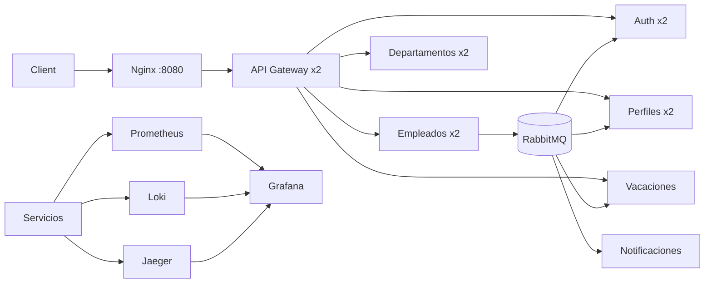

# Arquitectura

Los servicios son dueños de su base de datos. RabbitMQ distribuye eventos de dominio; ningún
servicio consulta directamente la base de datos de otro servicio. Nginx balancea el Gateway y el
DNS interno de Docker balancea las réplicas de servicios stateless.

Vacaciones se conserva en una sola réplica porque ejecuta un scheduler. Antes de escalarlo se debe
usar un lock distribuido/advisory lock para impedir publicaciones duplicadas.
